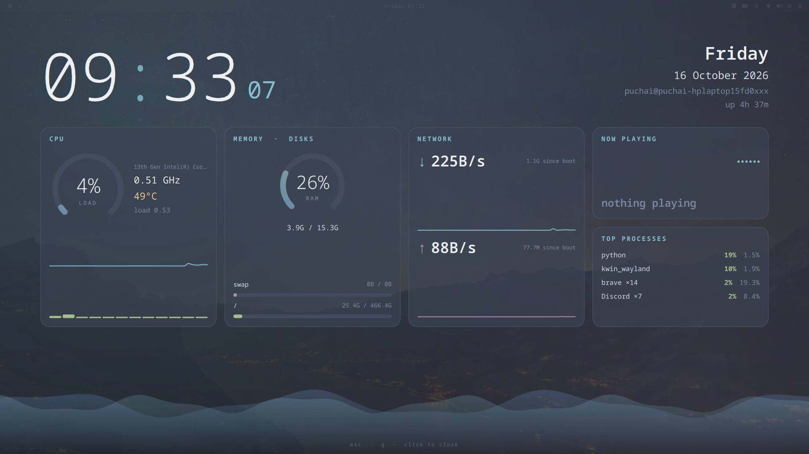

# rice-dash

[](screenshots/overlay.png)

A Nord-themed system dashboard for Linux, in three parts:

| What | Where | Built with | Use it when |
| --- | --- | --- | --- |
| **Quickshell overlay** | [`quickshell/`](quickshell/) | QML only | You are on a Wayland desktop and want the lightest overlay. This is the recommended one. |
| **Terminal dashboard** | [`dash.py`](dash.py) | Python, [Textual](https://textual.textualize.io/) | You want the stats inside a terminal pane. Works on X11 and Wayland. |
| **PyQt overlay** | [`dash-overlay.py`](dash-overlay.py) | Python, PyQt6, QML | You are on X11 or Windows, or you do not want to install Quickshell. |

The two overlays look the same and show the same stats. The Quickshell version is a port of the PyQt one with the Python layer removed.

## What it shows

| Panel | Details |
| --- | --- |
| Clock | Big clock with seconds, date, user@host, uptime |
| CPU | Load gauge, frequency, temperature, load average, history graph, per-core bars |
| Memory and disks | RAM gauge, swap and disk usage bars |
| Network | Live download and upload rates with history graphs |
| Now playing | Track, artist and progress of whatever is playing (needs `playerctl`) |
| Top processes | The busiest processes, grouped by name |
| Pulse | A wave along the bottom that speeds up and grows with CPU load. It is animated in the PyQt overlay. In the Quickshell overlay it is drawn once and kept still to save CPU. |

## Quickshell overlay

A fullscreen, animated overlay that runs as a layer-shell window. It needs no Python at all: stats come straight from `/proc`, plus small `top`, `df` and `playerctl` calls. It only polls while it is open, and everything is released when it closes.

Tested on KDE Plasma 6 (Wayland) on EndeavourOS. It should work on other Wayland compositors that support the layer-shell protocol, but those are untested.

### Requirements

- A Wayland session
- [Quickshell](https://quickshell.org/)
- Optional: `playerctl` for the now-playing card, and the JetBrains Mono font

On Arch-based systems:

```
yay -S quickshell
sudo pacman -S --needed playerctl ttf-jetbrains-mono
```

### Install

```
git clone https://github.com/HonourableAF/rice-dash.git
cd rice-dash

mkdir -p ~/.config/quickshell
cp quickshell/{shell,Dash,Stats}.qml ~/.config/quickshell/
install -Dm755 quickshell/dash-toggle ~/.local/bin/dash-toggle
```

This uses Quickshell's default config location, so it replaces any `~/.config/quickshell/shell.qml` you already have. Make sure `~/.local/bin` is on your `PATH`.

### Use it

Run `dash-toggle`. It opens the overlay, and running it again closes it. You can also close it with `Esc`, `q`, or a click.

To bind it to a key on KDE Plasma: System Settings, then Keyboard, then Shortcuts, then Add New, then Command or Script, and use `dash-toggle`.

To try it without installing the script:

```
quickshell
quickshell ipc call dash toggle
```

The second command closes the overlay from another terminal.

### Files

| File | Job |
| --- | --- |
| `shell.qml` | Entry point. Starts the overlay and exposes the `toggle` IPC call. |
| `Dash.qml` | The overlay window and every panel. Colours and layout live here. |
| `Stats.qml` | Collects the system stats once a second and hands them to `Dash.qml`. |
| `dash-toggle` | Closes the overlay if it is running, otherwise starts it. |

### How it works

- `Stats.qml` reads `/proc/stat`, `/proc/meminfo`, `/proc/net/dev`, `/proc/loadavg`, `/proc/uptime` and `/proc/cpuinfo`, and finds the CPU temperature sensor under `/sys/class/hwmon`.
- Top processes come from `top`, disks from `df`, and now-playing from `playerctl`.
- `dash-toggle` first tries `quickshell ipc call dash toggle`. If nothing is running, it starts Quickshell instead.

### Bring the wave back to life

The pulse wave is the most expensive thing on screen because it repaints about 15 times a second. To make it animate again, find this line in `Dash.qml`:

```
function onTChanged() { wave.phase += 0.07 * (1 + 2 * win.energy) }
```

and change it to:

```
function onTChanged() { wave.phase += 0.07 * (1 + 2 * win.energy); wave.requestPaint() }
```

### Troubleshooting

- **Nothing appears:** run `quickshell` in a terminal and read the output. Warnings about missing icon themes are harmless.
- **Now playing says "nothing playing":** install `playerctl` and start a media player.
- **Keys do nothing:** click anywhere on the overlay to close it, or run `pkill quickshell`.

## Terminal dashboard

`dash.py` is a single file. [`uv`](https://docs.astral.sh/uv/) reads its dependencies from the script header and installs them on first run, so there is no virtualenv to set up.

```
uv run dash.py
```

Press `q` to quit. Colours are constants at the top of the file.

Requires Linux with Python 3.10 or newer. On Arch-based systems: `sudo pacman -S --needed uv`.

## PyQt overlay (X11 and Windows)

`dash-overlay.py` is the original overlay. It is a single file that `uv` runs the same way:

```
uv run dash-overlay.py
```

- Close it with `Esc`, `q`, or a click.
- Run the command again while it is open to close it, so one keyboard shortcut can both open and close it.
- On KDE Plasma, bind `uv run /path/to/rice-dash/dash-overlay.py` as a Command shortcut.

Optional extras:

- **Blur behind the overlay (KDE):** the overlay registers the app ID `rice-dash`. Create a KWin Window Rule that matches that window class and set Blur to Force Yes.
- **Desktop entry:** if you see a harmless warning about the desktop portal not finding the app ID, create `~/.local/share/applications/rice-dash.desktop`:

```
[Desktop Entry]
Type=Application
Name=rice-dash
Exec=uv run /path/to/rice-dash/dash-overlay.py
Icon=utilities-system-monitor
Categories=System;Monitor;
```

How it works: `psutil` provides the stats, the overlay collects them once a second in Python and hands them to QML as a single object, and a second launch talks to the first over a local socket, which is how the toggle works.

### Windows (experimental)

The PyQt overlay runs on Windows. The Quickshell overlay does not, because Quickshell only exists for Wayland.

Windows support is checked automatically: a GitHub Actions job starts the overlay on a Windows runner on every push. The author develops on Linux, so nobody has looked at it on a real Windows screen yet. Please open an issue if something looks wrong.

```
winget install astral-sh.uv
git clone https://github.com/HonourableAF/rice-dash.git
cd rice-dash
uv run dash-overlay.py
```

Install the JetBrains Mono font first, or the layout falls back to another font.

Differences from Linux:

- **Now playing** needs a few extra packages. Run it like this to turn it on:

```
uv run --with winrt-runtime --with winrt-Windows.Media.Control --with winrt-Windows.Foundation --with winrt-Windows.Foundation.Collections dash-overlay.py
```

- **CPU temperature** shows a dash, because Windows does not expose it without extra tools.
- **Top processes** leave out the System Idle Process.
- **Shortcut:** use an [AutoHotkey](https://www.autohotkey.com/) v2 script, for example `^!d::Run 'uv run "C:\path\to\rice-dash\dash-overlay.py"', , 'Hide'`. Running it again closes the overlay.
- **Known risk:** a fullscreen window with a see-through background can render oddly on some Windows setups.

## Customising

- Colours are plain hex values. In `dash.py` they are constants at the top of the file. In the overlays they appear inside the QML (`quickshell/Dash.qml`, or the QML block in `dash-overlay.py`).
- The overlay panels are `Card` items, so adding or removing one means editing a single block.
- To change what is measured in the Quickshell version, edit `quickshell/Stats.qml`.

## Performance notes

The overlays redraw the screen about 15 times a second while open, so they use some CPU. The percentage you see depends heavily on your power profile: on battery or in balanced mode the CPU runs at a lower clock, so the same work shows as a higher percentage than in performance mode. It does not mean the overlay costs more energy there.

The Quickshell version avoids running Python and PyQt, and it only polls while it is open. Measure both on your own machine to compare.
